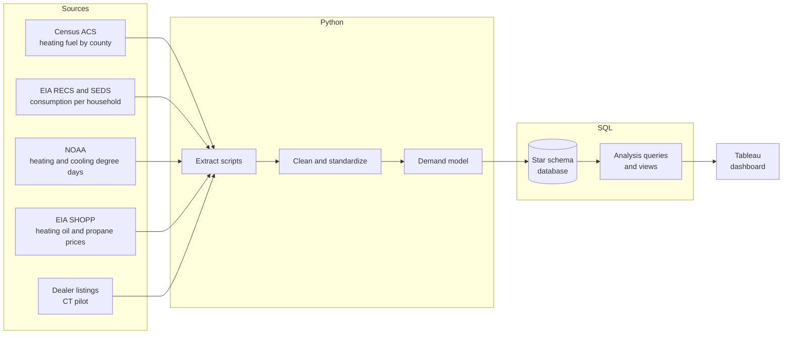
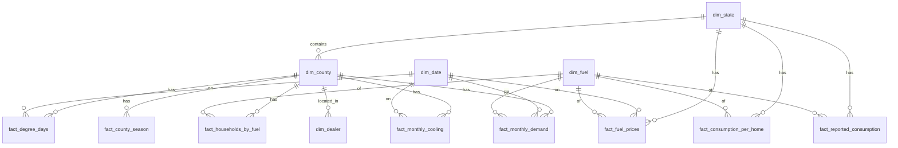

# Northeast Heating & Cooling Demand Map

**Where and when does the Northeast need heating fuel and AC service, and which fuel dealers serve that demand?**

An end-to-end analytics project that estimates month-by-month heating oil, propane, and air conditioning demand for every county in the nine Northeast states, stores it in a relational database, and visualizes it in an interactive Tableau dashboard.

> **Status:** Data, demand model, and SQL database complete. Building the Tableau dashboards next. Early results are in [`docs/findings.md`](docs/findings.md). See the [Roadmap](#roadmap) for progress.

---

## Table of Contents

1. [Why This Project](#why-this-project)
2. [Business Questions](#business-questions)
3. [Scope](#scope)
4. [Tech Stack](#tech-stack)
5. [Pipeline Architecture](#pipeline-architecture)
6. [Data Sources](#data-sources)
7. [Methodology](#methodology)
8. [Database Design](#database-design)
9. [SQL Analysis Plan](#sql-analysis-plan)
10. [Tableau Dashboard Plan](#tableau-dashboard-plan)
11. [Repository Structure](#repository-structure)
12. [Running the Pipeline](#running-the-pipeline)
13. [Limitations](#limitations)
14. [Roadmap](#roadmap)
15. [Author](#author)

---

## Why This Project

The Northeast is the heating oil capital of the United States, and propane is common in its rural areas. These fuels are sold by thousands of mostly family-owned, regional dealers. Many of them are **full-service dealers**: they deliver fuel in winter and install and repair furnaces, boilers, and AC systems year-round.

That creates a seasonal business with two peaks:

- **Winter:** fuel delivery volume spikes with cold weather.
- **Summer:** fuel slows down, but AC installs and repairs pick up.

Software companies that serve these dealers (dispatch, routing, billing, and service platforms) need to know where the demand is, how it moves through the year, and which dealers are the best fit for their product. This project builds that view from public data.

---

## Business Questions

**Demand**
1. Which Northeast counties have the most homes heating with oil or propane?
2. How does estimated heating fuel demand change month by month?
3. In which months does demand peak, and how sharp is the peak in each state?

**Seasonality and service**
4. Where is cooling (AC) demand strong enough to keep full-service dealers busy in summer?
5. Which counties have both high heating fuel demand and high cooling demand, making them the best markets for year-round full-service dealers?

**Market value**
6. What is the estimated annual residential spend on heating oil and propane by county and state?
7. How have prices and weather-driven demand shifted across recent winters?

**Dealer opportunity (Connecticut pilot)**
8. How many fuel dealers serve each county, relative to the number of oil and propane homes?
9. Which dealers best fit a full-service software platform (offer HVAC service, mid-size, limited online tools)?

---

## Scope

| Dimension | Coverage |
|---|---|
| **Geography** | 9 Northeast states: CT, MA, RI, VT, NH, ME, NY, NJ, PA (218 counties; Connecticut is reported as 9 planning regions) |
| **Fuels** | Heating oil (No. 2 fuel oil and kerosene), propane, plus AC as a cooling demand index |
| **Time** | Monthly, most recent 5 heating seasons |
| **Granularity** | County (households and modeled demand), state (consumption, prices, degree days) |
| **Dealer layer** | Connecticut first, then expandable to other states |

---

## Tech Stack

| Layer | Tool | Purpose |
|---|---|---|
| **Data collection** | Python (`requests`, `pandas`, `BeautifulSoup`) | Download Census, EIA, and NOAA public files (no API keys needed), scrape dealer listings |
| **Cleaning and modeling** | Python (`pandas`, `numpy`, `geopandas`) | Standardize geography codes, convert units, build the demand model |
| **Storage** | SQL (SQLite for development, PostgreSQL optional) | Star schema with dimension and fact tables |
| **Analysis** | SQL (CTEs, window functions, views) | Answer the business questions and produce Tableau-ready views |
| **Visualization** | Tableau Public | Interactive maps, month slider, rankings, KPIs |
| **Version control** | Git and GitHub | Code, SQL, documentation |

---

## Pipeline Architecture



**Flow in plain terms:** Python collects raw files from public sources, cleans them into consistent tables, and runs the demand model. The results load into a SQL database. SQL queries answer the business questions and expose clean views. Tableau connects to those views (or CSV exports) to build the dashboard.

---

## Data Sources

All sources are public and free.

| # | Dataset | Publisher | Level | Frequency | Used For |
|---|---|---|---|---|---|
| 1 | American Community Survey, table **B25040** (House Heating Fuel), from the ACS summary file | U.S. Census Bureau | County | Annual (5-year estimates) | Number of homes heating with oil, propane, gas, electricity |
| 2 | Residential Energy Consumption Survey (**RECS**) 2020 microdata | U.S. EIA | State, Census division | Survey years (2020; 2024 releasing) | Average fuel use per household, split by space heating and water heating; AC ownership |
| 3 | State Energy Data System (**SEDS**) | U.S. EIA | State | Annual | Total residential distillate and propane consumption, used to calibrate the model |
| 4 | Climate Divisional Dataset (**nClimDiv**), county degree days | NOAA NCEI | County | Monthly | Heating degree days (HDD) and cooling degree days (CDD), the monthly demand pattern |
| 5 | Climate Divisional Dataset (**nClimDiv**), statewide degree days | NOAA NCEI | State | Monthly | State-level weather for calibration and summaries |
| 6 | State Heating Oil and Propane Program (**SHOPP**) | U.S. EIA | State, PADD region | Weekly (Oct to Mar); summer data is sparse | Residential heating oil and propane prices |
| 7 | Monthly residential electricity sales (Form EIA-861M) | U.S. EIA | State | Monthly | Validates summer cooling demand |
| 8 | Cartographic boundary files (2024, plus 2020 for old Connecticut counties) | U.S. Census Bureau | County | Annual | Map shapes, FIPS codes, Connecticut crosswalk |
| 9 | Heating fuel dealer listings | CT Department of Consumer Protection registrations (to be confirmed), dealer websites, map listings | Business | One-time snapshot | Dealer locations, services offered, online tools |

---

## Methodology

There is no public dataset of actual heating fuel gallons burned per month by county. This project **models** it by combining the sources above. All outputs are estimates, and every assumption is documented.

### Step 1: Homes by fuel type (county)
From ACS B25040: number of occupied homes using fuel oil/kerosene and propane (bottled, tank, or LP gas) as their main heating fuel.

### Step 2: Annual fuel use per home (state)
From RECS: average annual consumption per household using each fuel, split into:
- **Space heating** (weather-driven)
- **Water heating and other uses** (roughly constant through the year)

Converted from million Btu to gallons:

| Fuel | Btu per gallon |
|---|---|
| Heating oil (No. 2) | 138,500 |
| Propane | 91,500 |

### Step 3: Gallons per degree day
A heating degree day (HDD) measures how much colder than 65°F a day was. More HDD means more heating fuel burned. RECS reports space heating use for 2020, so dividing it by 2020's degree days for the same homes gives a usage rate:

```
gal_per_hdd(state, fuel) = space_heat_gal_per_home(state, fuel) / HDD_2020(state, fuel homes)
```

### Step 4: Monthly demand estimate (the core formula)

```
est_gallons(county, fuel, month) =
    homes(county, fuel)
  × [ gal_per_hdd(state, fuel) × HDD(county, month)
    + base_gal_per_home(state, fuel) / 12 ]
```

Using each county's actual degree days means colder counties and colder winters burn more fuel, so the model shows how demand shifts from one winter to the next.

### Step 5: Dollar value

```
est_spend(county, fuel, month) = est_gallons × avg_price(state, fuel, month)
```

### Step 6: Cooling (AC) demand index
AC is not measured in gallons, so cooling is scored as an index:

```
cooling_index(county, month) = homes_with_ac(county) × CDD(state, month)
```

Home AC ownership comes from RECS state shares applied to county household counts.

### Step 7: Calibration
Modeled state totals are compared against EIA SEDS reported residential consumption for 2022 to 2024, and each state and fuel gets a scaling factor (0.73 to 1.72). The model starts low because SEDS also counts homes that use oil or propane only as a backup or for hot water, so the calibrated figure estimates the whole residential market. Both versions are kept.

### Step 8: Year-round opportunity score
To find the best markets for full-service dealers:

```
year_round_score = percentile(heating_spend) × 0.6 + percentile(cooling_index) × 0.4
```

The sensitivity check showed the weights barely change the ranking (Spearman 0.98 or more for any mix from 50/50 to 80/20), but scoring on totals mostly measures county size. A per-home version of the score is saved alongside it to show market intensity.

---

## Database Design

A **star schema**: dimension tables describe *who, where, when*; fact tables hold the measurements.



The schema is in [`sql/schema/01_create_tables.sql`](sql/schema/01_create_tables.sql). It runs on SQLite; the database file is rebuilt by `src/load/build_database.py` and not committed.

### Dimension tables

| Table | Rows | Key Columns |
|---|---|---|
| `dim_state` | 9 | `state_fips`, `state_abbr`, `state_name`, `census_division` |
| `dim_county` | 218 | `county_fips`, `state_fips`, `county_name`, `land_area_sqmi`, `latitude`, `longitude` |
| `dim_date` | 444 | `date_key` (YYYYMM), `year`, `month`, `month_name`, `heating_season` (e.g. 2024-25), `is_heating_month` |
| `dim_fuel` | 9 | `fuel_id`, `fuel_name`, `btu_per_gallon`, `unit`, `is_modeled` |
| `dim_dealer` | Phase 6 | `dealer_id`, `name`, `county_fips`, `town`, `fuels_offered`, `offers_hvac_service`, `has_online_payment`, `has_customer_portal`, `est_size_band`, `website` |

### Fact tables

| Table | Grain | Rows | Key Measures |
|---|---|---|---|
| `fact_households_by_fuel` | county × fuel × ACS period | 1,962 | `households`, `margin_of_error`, `share_of_county_homes` |
| `fact_consumption_per_home` | state × fuel × end use | 36 | `gallons_per_home`, `mmbtu_per_home`, `recs_sample_n` |
| `fact_degree_days` | county × month (1991 on) | 93,522 | `hdd`, `cdd`, `hdd_normal`, `cdd_normal` |
| `fact_fuel_prices` | state × fuel × month | 4,446 | `avg_price_per_gallon`, `price_source` |
| `fact_monthly_demand` | county × fuel × month | 26,160 | `est_gallons`, `est_gallons_uncalibrated`, `est_spend` |
| `fact_monthly_cooling` | county × month | 13,080 | `ac_homes`, `cdd`, `cooling_index` |
| `fact_county_season` | county × heating season | 1,090 | season totals, `year_round_score`, `quadrant` (both bases) |
| `fact_reported_consumption` | state × fuel × year | 270 | `gallons` (EIA SEDS, for calibration) |

Degree days ended up at county grain (NOAA publishes them that way), and cooling got its own fact table because it has no fuel.

---

## SQL Analysis Plan

Each analysis is a saved query in `sql/analysis/`. The most useful results also become views for Tableau.

| # | Analysis | SQL Techniques |
|---|---|---|
| 1 | Top 25 counties by estimated annual heating oil and propane spend | Aggregation, `RANK()` |
| 2 | Peak month and peak-to-average ratio by state | CTEs, `MAX() OVER (PARTITION BY ...)` |
| 3 | Winter vs. summer demand balance: counties strong in both seasons | Conditional aggregation (`CASE WHEN`), percentiles |
| 4 | Heating season comparison: how much colder or warmer each winter was vs. normal, and the effect on demand | CTEs, weighted averages, `LAG()` |
| 5 | Price trends and volatility by state and fuel | Moving averages, standard deviation (computed, since SQLite has no `STDDEV`) |
| 6 | Oil-to-propane mix by county (urban oil vs. rural propane pattern) | Ratios, `NTILE()` |
| 7 | Dealer density: oil and propane homes per dealer by county (CT). *Phase 6, needs dealer data* | Joins with dealer table, `LEFT JOIN` gaps |
| 8 | Dealer fit score and ranked prospect list (CT). *Phase 6, needs dealer data* | Weighted scoring, `ROW_NUMBER()` |
| 9 | Model calibration: modeled vs. reported state consumption | Joins, percent error |

**Tableau views:** `vw_county_month_demand`, `vw_county_annual_summary`, `vw_state_seasonality` (built), and `vw_dealer_opportunity` (Phase 6). Tableau Public cannot connect to SQLite, so each view is also exported to `data/processed/tableau/`. Query results are saved in `data/processed/analysis/`.

---

## Tableau Dashboard Plan

Published on **Tableau Public**.

### Dashboard 1: Seasonal Demand Map
- County choropleth map of the Northeast
- **Month slider** (animate from July to January to watch demand shift from cooling to heating)
- Toggle: heating oil, propane, AC cooling index
- Tooltip: homes on each fuel, estimated gallons, estimated spend

### Dashboard 2: Market Overview
- KPI tiles: total estimated annual spend, oil homes, propane homes, peak month
- State-level seasonality line chart (HDD and CDD by month)
- Top 25 counties bar chart
- Price trend chart by fuel

### Dashboard 3: Year-Round Opportunity
- Scatter plot: heating spend (x) vs. cooling index (y), one point per county
- Quadrants labeled: *Winter only*, *Summer only*, *Year-round*, *Low demand*
- Filter by state

### Dashboard 4: Connecticut Dealer Opportunity
- Dealer locations over county demand
- Homes per dealer by county
- Ranked prospect table with fit score

---

## Repository Structure

```
northeast-heating-demand-map/
├── README.md
├── requirements.txt
├── .gitignore
├── data/
│   ├── raw/              # Original downloads (not committed if large)
│   ├── interim/          # Cleaned intermediate files
│   └── processed/        # Final tables and Tableau exports
├── src/
│   ├── extract/          # One script per source (census, eia, noaa, dealers)
│   ├── transform/        # Cleaning, unit conversion, FIPS standardization
│   ├── model/            # Demand model and calibration
│   └── load/             # Load processed tables into the database
├── sql/
│   ├── schema/           # CREATE TABLE statements
│   ├── analysis/         # Business question queries
│   └── views/            # Views consumed by Tableau
├── notebooks/            # Exploration and validation
├── tableau/              # Workbook and dashboard screenshots
└── docs/
    ├── data_dictionary.md
    ├── assumptions.md
    └── findings.md
```

---

## Running the Pipeline

```bash
python3 -m venv .venv
.venv/bin/pip install -r requirements.txt
.venv/bin/python -m src.extract.run_all
.venv/bin/python -m src.model.run_all
.venv/bin/python -m src.load.build_database
```

The first command downloads every source into `data/raw/` (about 285 MB, cached after the first run) and writes clean tables to `data/interim/`; neither folder is committed. The second runs the demand model and writes the results to `data/processed/`, which is committed. The third builds the SQLite database (`data/northeast_demand.db`), runs every query in `sql/analysis/`, and exports the Tableau views. Each table is described in [`docs/data_dictionary.md`](docs/data_dictionary.md), and the choices made along the way are in [`docs/assumptions.md`](docs/assumptions.md).

---

## Limitations

- **Modeled, not measured.** County monthly demand is an estimate built from state averages and weather. It shows patterns and relative size well, but it is not an exact gallon count.
- **State-level consumption rates.** RECS publishes fuel use per household at the state level, so homes within a state are assumed to use similar amounts.
- **Survey margins of error.** ACS county estimates have margins of error, larger in small rural counties.
- **Heating fuel is primary fuel only.** ACS records each home's main heating fuel. Homes using oil or propane as a backup are not counted.
- **Prices are state averages.** Local dealer prices vary.
- **Dealer list is a snapshot.** Dealer data is collected once and checked manually, and some small dealers may be missing.
- **AC index is relative.** The cooling index ranks counties by likely AC service demand but is not a dollar estimate.

---

## Roadmap

**Phase 1: Planning**
- [x] Define business questions and scope
- [x] Identify data sources
- [x] Design methodology and database schema
- [x] Write project documentation

**Phase 2: Data collection (Python)**
- [x] Census ACS B25040 for all Northeast counties
- [x] NOAA monthly heating and cooling degree days (county level)
- [x] EIA RECS consumption per household
- [x] EIA SHOPP heating oil and propane prices
- [x] EIA SEDS state consumption for calibration
- [x] EIA 861M monthly residential electricity sales
- [x] County boundaries and FIPS lookup
- [x] Connecticut planning region crosswalk

**Phase 3: Modeling (Python)**
- [x] Clean and standardize all sources
- [x] Build monthly demand model
- [x] Calibrate against SEDS
- [x] Sensitivity check on assumptions

**Phase 4: Database and analysis (SQL)**
- [x] Create star schema
- [x] Load processed tables
- [x] Write analysis queries 1 to 6 and 9 (7 and 8 need the dealer data from Phase 6)
- [x] Build Tableau views (and CSV exports for Tableau Public)

**Phase 5: Dashboard (Tableau)**
- [ ] Seasonal demand map with month slider
- [ ] Market overview
- [ ] Year-round opportunity scatter
- [ ] Publish to Tableau Public

**Phase 6: Dealer layer (Connecticut)**
- [ ] Collect and verify CT dealer list
- [ ] Enrich with services and online tools
- [ ] Fit score and prospect ranking
- [ ] Add Dashboard 4

**Phase 7: Findings**
- [ ] Write top findings in `docs/findings.md`
- [ ] Add dashboard screenshots to this README

---

## Author

**Dhruv Khanna**
MS Business Analytics, Quinnipiac University
Hamden, Connecticut
